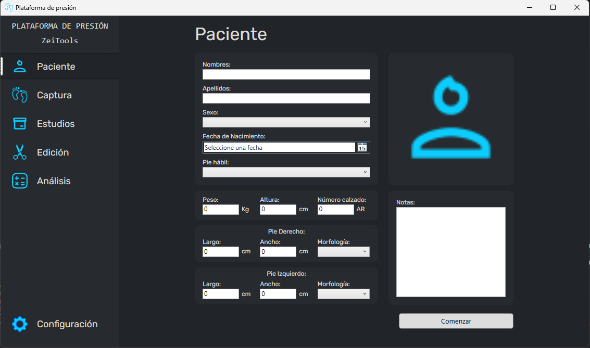
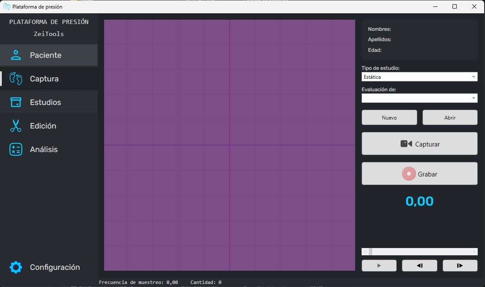
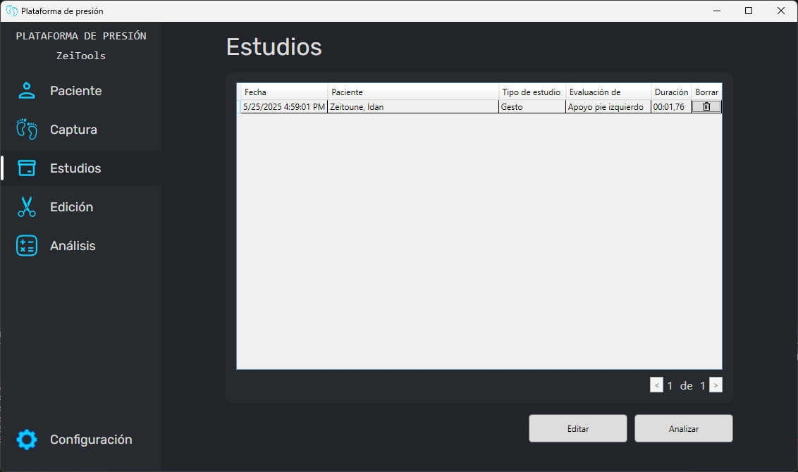
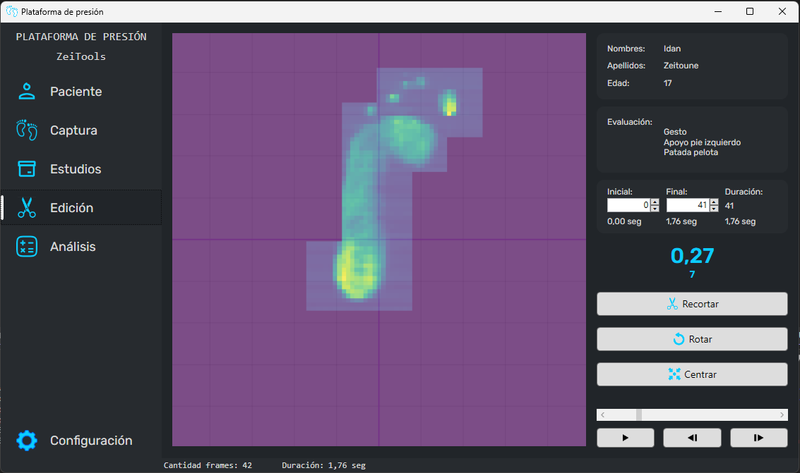
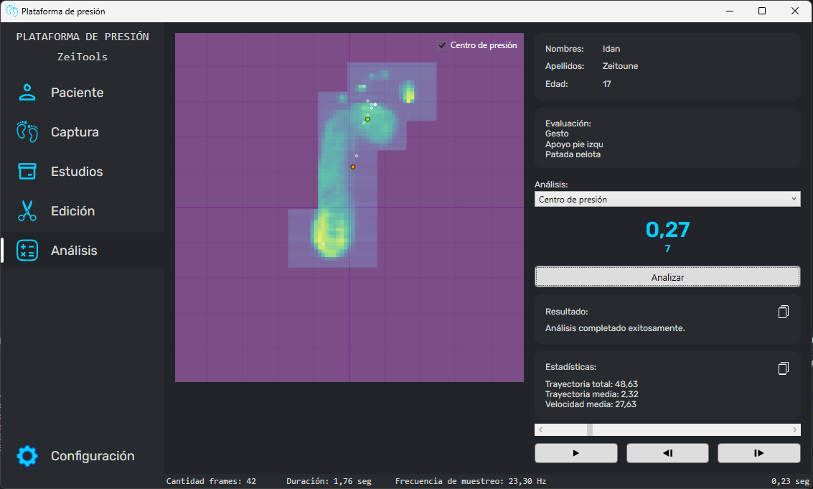

<h1 align="center" style="color:#00A6D6">Open Pressure Analysis Platform</h1>

<p align="center">
  <i>Acquisition, Visualization and Extensible Biomechanical Analysis</i>
</p>

[Versión en español](README.md)

An extensible software platform for pressure data acquisition, visualization, processing, and biomechanical analysis, featuring user-defined Python algorithms. 

It allows users to register patients, organise studies, visualise pressure data and run external analysis algorithms developed in Python.

> This guide is intended for users who want to use the application without needing to know the source code, and to extend its functionality by creating Python analysis scripts.

## Main features

- Patient management and basic patient information.
- Creation and consultation of studies.
- Registration and visualisation of tests performed with the platform.
- Pressure map visualisation and frame navigation.
- Execution of analysis algorithms written in Python.
- Display of analysis results and statistics.
- Calculation time display.
- Device and platform parameter configuration.
- Use of a physical platform or a simulator, depending on the available configuration.

## Requirements

- Windows 10 or later.
- .NET 8 Desktop Runtime for Windows, when using a published version that is not self-contained.
- A compatible force platform or the device simulator.
- Python 3 installed and available as `python` from the terminal. This is only required when running analysis algorithms.
- The dependencies required by the Python algorithm being used.

To check whether Python is available:

```powershell
python --version
```

If the command is not recognised, install Python and enable **Add Python to PATH**, or configure the Python path manually.

To install NumPy, which is used by the provided algorithms:

```powershell
pip install numpy
```

## Installation

### Option 1: Clone the repository

Clone the analysis scripts repository using:

```powershell
git clone https://github.com/angel-zeitoune/Open-Pressure-Platform-Analysis.git
```

### Option 2: Download the published application

Download the published application as a ZIP file and extract it to a local folder.

## Starting the application

When the application starts, configure the device and check that the connection is available. If you do not have access to the physical device, select the simulator when this option is available.

Before taking a measurement, make sure that:

- The patient is registered or selected.
- The corresponding study is available.
- The platform is connected and ready to measure.
- The patient is correctly positioned on the platform.

## Recommended workflow

### 1. Register or select a patient

Open the patient section and create a new record or select an existing one. Enter the requested information and save it.

### 2. Create or open a study

Select the patient and create a new study, or open an existing study to consult its measurements and results.

### 3. Perform a test

From the test section:

1. Select the type of test.
2. Check that the platform is ready.
3. Start the measurement.
4. Wait for the capture to finish.
5. Save the test associated with the study.

The available options may vary depending on the device and installed configuration.

### 4. Review the measurement

Open the analysis view to review the test. In this view you can:

- Observe the pressure map.
- Move between frames using the navigation controls.
- Consult the legend for the displayed data.
- Review statistics associated with the measurement.
- Check the calculation time.

### 5. Run an algorithm

In the analysis view:

1. Select the available algorithm `.py` file.
2. Click **Analyse**.
3. Wait for the processing to finish.
4. Review the displayed result and statistics.

The application sends the test data to the Python process through standard input and receives the result through standard output.

## Results and storage

Patients, studies and tests are managed by the application and stored according to the project configuration. Regular backups of the data folder are recommended before updating the application or moving it to another computer.

Do not manually delete or modify data files without making a backup first.

## Writing Python algorithms

The existing algorithms can be used as a starting point.

A detailed guide explaining how to create new algorithms will be added soon. For questions, contact us by email or use the Discord channel.

## Screenshots

### Patient registration



### Test registration



### Studies



### Study editing view



### Analysis view



## Project information

- Application type: WPF desktop application.
- Platform: Windows x64.
- Framework: .NET 8.
- External analysis: Python scripts selected by the user.

## Licence and support

The .NET application and its proprietary components are distributed under a proprietary licence. Commercial use of the application is permitted, but selling, redistributing, sublicensing or commercialising it is not permitted. Reverse engineering is also prohibited, except where expressly allowed by applicable law.

The Python analysis scripts are distributed under the MIT License. They may be modified and redistributed as long as the copyright notice and licence text are retained.

- [Proprietary licence for the .NET application](LICENSE.md)
- [MIT License for the Python scripts](LICENSE-PYTHON.md)
- Third-party components: see their respective notices and licences.

- Contact: **zeitools.contacto@gmail.com**
