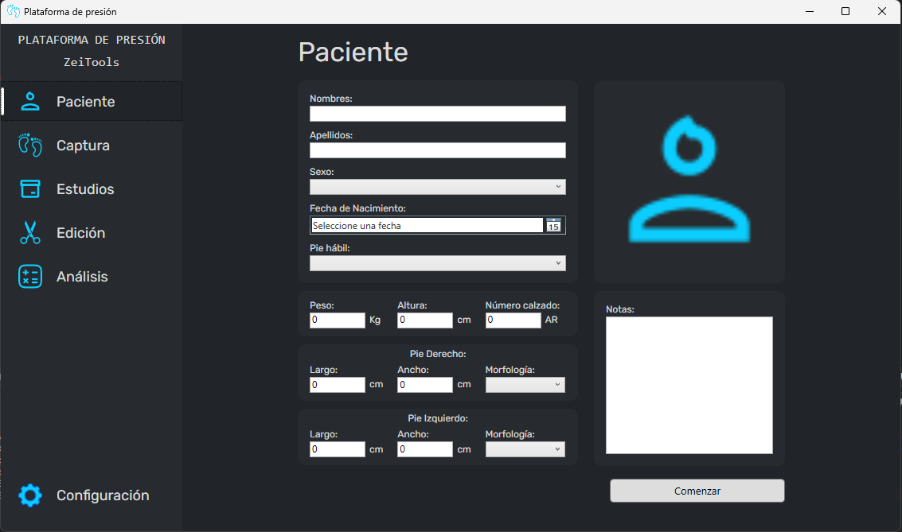
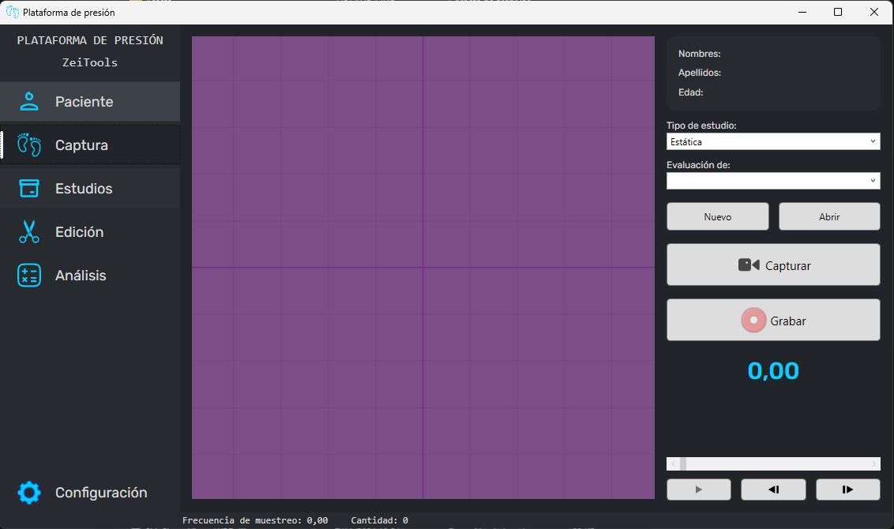
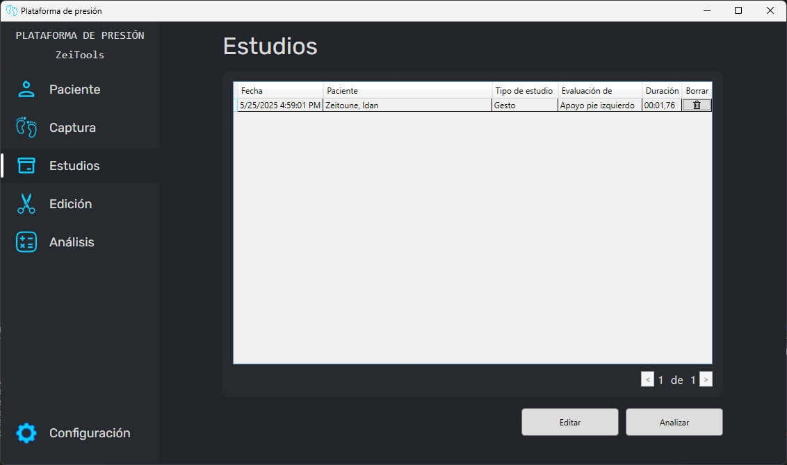
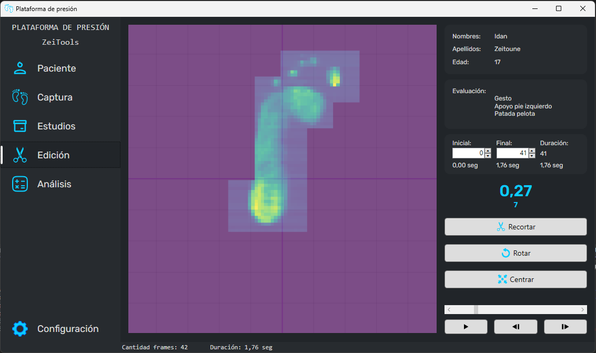
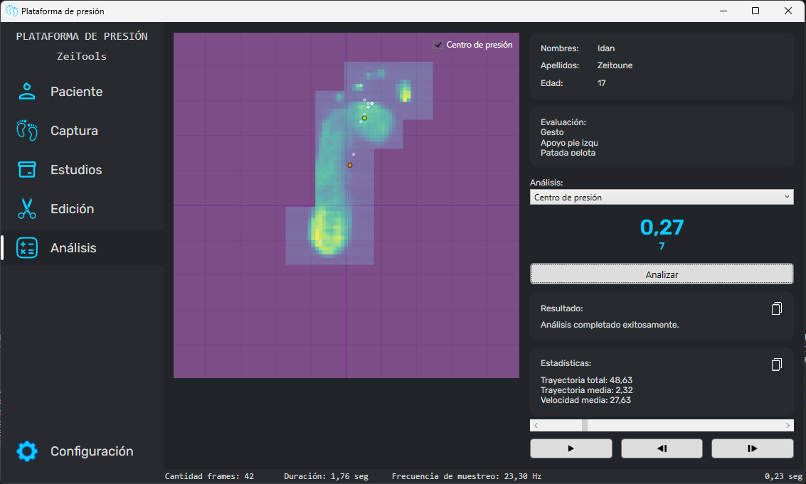

<h1 align="center" style="color:#00A6D6">Open Pressure Analysis Platform</h1>

<p align="center">
  <i>Adquisición, visualización y análisis biomecánico extensible</i>
</p>

[English version](README.en.md)

Una plataforma de software extensible para la adquisición, visualización y procesamiento de datos de presión, así como para el análisis biomecánico, que incorpora algoritmos en Python definidos por el usuario.

Permite registrar pacientes, organizar estudios, visualizar datos de presión y ejecutar algoritmos de análisis externos desarrollados en Python.

> Esta guía está dirigida a usuarios interesados en utilizar la aplicación sin necesidad de conocer el código fuente y extender sus funciones mediante la creación de script de análisis en python.

## Características principales

- Gestión de pacientes y sus datos básicos.
- Creación y consulta de estudios.
- Registro y visualización de pruebas realizadas con la plataforma.
- Visualización de mapas de presión y navegación entre frames.
- Ejecución de algoritmos de análisis escritos en Python.
- Visualización de resultados y estadísticas del análisis.
- Consulta del tiempo de cálculo.
- Configuración de dispositivos y parámetros de la plataforma.
- Uso de una plataforma física o de un simulador, según la configuración disponible.

## Requisitos

- Windows 10 o superior.
- .NET 8 Desktop Runtime para Windows, si se utiliza una versión publicada que no sea autocontenida.
- Una plataforma de fuerzas compatible o el simulador de dispositivo.
- Python 3 instalado y accesible como `python` desde la terminal (solo necesario si va a ejecutar algoritmos de análisis).
- Dependencias requeridas por el algoritmo Python que se quiera ejecutar (solo necesario si va a ejecutar algoritmos de análisis).

Para comprobar que Python está disponible:

```powershell
python --version
```

Si el comando no se reconoce, instale Python y habilite **Add Python to PATH**, o configure manualmente la ruta de Python.

Para instalar numpy (utilizado en los algoritmos provistos):

```powershell
pip install numpy
```

## Instalación

Opción 1. Clone el repositio de git mediante el comando:

```powershell
git clone https://github.com/angel-zeitoune/Open-Pressure-Platform-Analysis.git
```

Opción 2. Descargue la versión publicada de la aplicación como zip. Extraiga los archivos en una carpeta local.

## Inicio de la aplicación

Al iniciar la aplicación, configure el dispositivo y compruebe que la conexión está disponible. Si no tiene acceso al dispositivo físico, seleccione el simulador cuando esta opción esté disponible.

Antes de realizar una medición, asegúrese de que:

- El paciente está registrado o seleccionado.
- El estudio correspondiente está disponible.
- La plataforma está conectada y lista para medir.
- El paciente está correctamente colocado sobre la plataforma.

## Flujo de uso recomendado

### 1. Registrar o seleccionar un paciente

Abra la sección de pacientes y cree un nuevo registro o seleccione uno existente. Introduzca los datos solicitados y guarde la información.

### 2. Crear o abrir un estudio

Seleccione el paciente y cree un estudio nuevo, o abra uno anterior para consultar sus mediciones y resultados.

### 3. Realizar una prueba

Desde la sección de pruebas:

1. Seleccione el tipo de prueba.
2. Compruebe que la plataforma está preparada.
3. Inicie la medición.
4. Espere a que finalice la captura.
5. Guarde la prueba asociada al estudio.

Las opciones disponibles pueden variar según el dispositivo y la configuración instalada.

### 4. Consultar la medición

Abra la vista de análisis para revisar la prueba. En esta vista se puede:

- Observar el mapa de presión.
- Cambiar de frame con los controles de navegación.
- Consultar la leyenda de los datos mostrados.
- Revisar estadísticas asociadas a la medición.
- Consultar el tiempo empleado en el cálculo.

### 5. Ejecutar un algoritmo

En la vista de análisis:

1. Seleccione el archivo `.py` del algoritmo disponible.
2. Pulse **Analizar**.
3. Espere a que finalice el procesamiento.
4. Revise el resultado y las estadísticas mostradas.

La aplicación envía los datos de la prueba al proceso Python mediante la entrada estándar y recibe el resultado a través de la salida estándar.


## Resultados y almacenamiento

Los pacientes, estudios y pruebas se gestionan desde la aplicación y se almacenan según la configuración del proyecto. Se recomienda realizar copias de seguridad periódicas de la carpeta de datos antes de actualizar la aplicación o cambiar de equipo.

No elimine ni modifique manualmente los archivos de datos sin realizar antes una copia de seguridad.


## Escritura de los algoritmos Python

Se puede tomar como base los algoritmos existentes.

Próximamente se incluirá una guía detallada de como crearlos. Cualquier duda puede escribir al email de contacto e interactuar mediante el canal de Discord.

## Capturas de pantalla

### Pantalla alta de un paciente



### Registro de una prueba



### Estudios



### Vista de edición de un estudio



### Vista de análisis



## Información del proyecto

- Tipo de aplicación: aplicación de escritorio WPF.
- Plataforma: Windows x64.
- Framework: .NET 8.
- Análisis externo: scripts Python seleccionables por el usuario.

## Licencia y soporte

La aplicación .NET y sus componentes propios se distribuyen bajo una licencia propietaria. Se permite el uso comercial de la aplicación, pero no su venta, redistribución, sublicencia ni comercialización. Tampoco se permite realizar ingeniería inversa, salvo cuando la legislación aplicable lo permita expresamente.

Los scripts de análisis Python se distribuyen bajo la licencia MIT. Pueden modificarse y redistribuirse siempre que se conserve el aviso de copyright y el texto de la licencia.

- [Licencia propietaria de la aplicación .NET](LICENSE.md)
- [Licencia MIT de los scripts Python](LICENSE-PYTHON.md)
- Componentes de terceros: consulte sus avisos y licencias correspondientes.

- Contacto: **zeitools.contacto@gmail.com**

